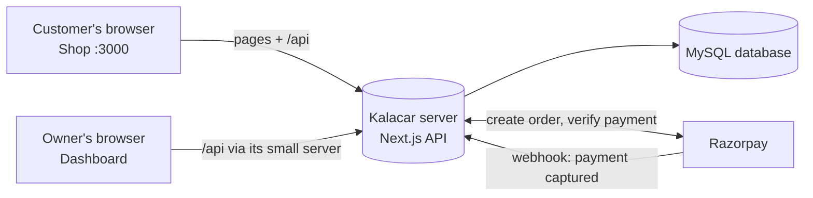
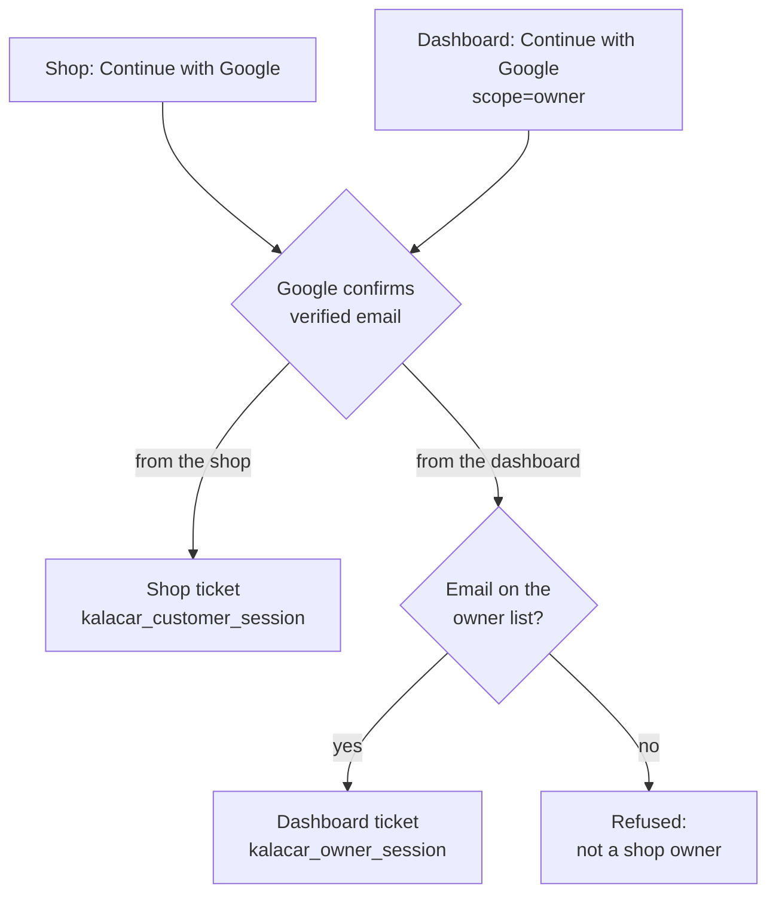
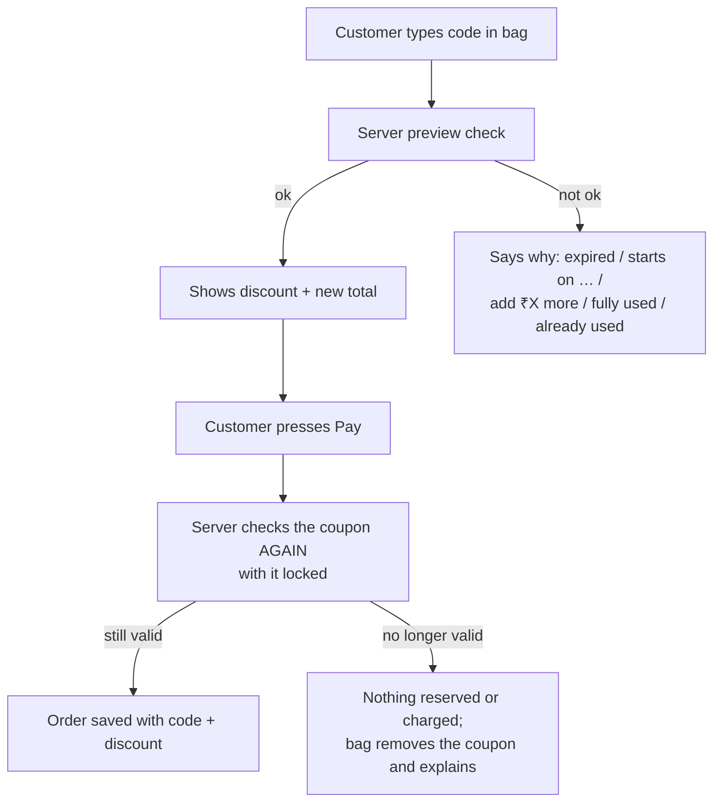
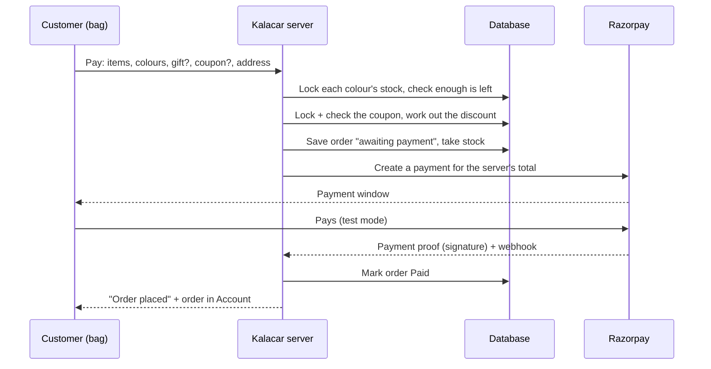
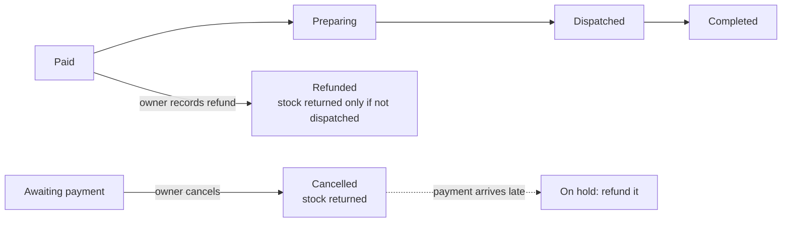

# 19 — How Kalacar Works

← [[18-woocommerce-parity-and-dashboard-spec]] · progress → [[16-progress-checklist]] · drawing → [[19-kalacar-flows.excalidraw]]

A plain-language tour of every feature that works today, for explaining the site to someone else. Each section says **what the person sees**, **what happens behind it**, and **the rule that keeps it safe**. The diagrams render directly in Obsidian; the same flows are drawn in [[19-kalacar-flows.excalidraw]] (Excalidraw plugin) and in `assets/kalacar-flows.excalidraw` (opens on excalidraw.com).

## Detailed flow drawings (Excalidraw)

Open any of these in Obsidian (Excalidraw view). They are generated from `flows/build_flows.py` — **edit a flow there and run `python3 flows/build_flows.py`; never hand-edit the drawings.** Plain copies for excalidraw.com are in `flows/excalidraw/`.

| # | Flow | Covers |
|---|---|---|
| 1 | [[flows/01-customer-journey.excalidraw\|Customer journey]] | Browse → product → colour → stock check → bag → gift + coupon → sign in → address → pay → account |
| 2 | [[flows/02-checkout-and-payment.excalidraw\|Checkout and payment]] | The 9 server steps when Pay is pressed, every refusal, Razorpay, signature check, webhook, window closed |
| 3 | [[flows/03-payment-retry-and-recovery.excalidraw\|Payment retry and recovery]] | Failed → Retry, abandoned → status check, owner cancel, late payment → On hold → refund |
| 4 | [[flows/04-order-lifecycle-owner.excalidraw\|Order lifecycle (owner)]] | Delivery status dropdown with Save, tracking note, refund and restock rule |
| 5 | [[flows/05-product-create-and-edit.excalidraw\|Products]] | Add/edit details, colours, specs, server checks, quick row save with conflict check, delete rule |
| 6 | [[flows/06-coupons.excalidraw\|Coupons]] | Owner rules, customer preview, re-check at payment, when a use counts or returns |
| 7 | [[flows/07-sign-in-and-account.excalidraw\|Sign-in and account]] | Two separate doors (shop / dashboard), owner list, addresses |
| 8 | [[flows/08-data-entities.excalidraw\|Data entities]] | Users, sessions, addresses, products, colours, orders, items, coupons, settings, payment events |
| 9 | [[flows/09-live-updates.excalidraw\|Live updates]] | How a saved change reaches open pages through Pusher, with timer backups; hidden and idle shop tabs make no requests. Developer guide: [[20-live-updates-architecture]] |
| 10 | [[flows/10-website-content.excalidraw\|Website content]] | How the owner changes pages, home sections, reviews and product settings from the dashboard, and the Contact form. |

The one-page overview is [[19-kalacar-flows.excalidraw]].

## The big picture: two websites, one server

Kalacar is **two separate websites** that share one server and one database:

| Part | Who uses it | Local address | Hosted test address | Built with |
|---|---|---|---|---|
| **Shop** (`kalacar-app`) | Customers | `localhost:3000` | `firebrick-squid-218523.hostingersite.com` | Next.js — pages **and** the server API |
| **Owner dashboard** (`kalacar-dashboard`) | Only the owner | `localhost:5173` | `sienna-herring-231344.hostingersite.com` | React (Vite) with a small server (`server.cjs`) that passes `/api`, `/images` and `/uploads` to the shop |
| **Database** | Nobody directly | MySQL (dev/test DB now) | Same database | Only the shop's server talks to it |
| **Razorpay** | Payment | Razorpay's site | Test mode only for now |

**Rule:** the two websites never share a sign-in or any other state. Signing in, out, or doing anything on one never changes the other (see "Sign-in").

---

## 1. Sign-in (two separate doors)

**Customer sees:** "Continue with Google" as the main option on the shop, with "Use email and password instead" underneath. After signing in from the bag, they return to the bag. **Owner sees:** "Continue with Google" on the dashboard.

**Behind it:** Google confirms who the person is. The server then gives the browser a **session cookie** — a random ticket it keeps a scrambled copy of.

**Rules**
- Google sign-in works only from Kalacar's listed addresses (`src/lib/public-origin.ts`), and each needs its callback in Google Cloud Console.
- Two different tickets: the shop ticket can never open the dashboard, even for the owner's own account.
- Only emails in `KALACAR_OWNER_EMAILS` can get a dashboard ticket.
- Sign-out on one site ends only that site's ticket.
- Too many sign-in attempts are slowed down (counted separately per site).

## 2. Browsing murtis

**Customer sees:** the catalogue — each card has a photo, badge (e.g. "Bestseller"), colour dots, the price ("from ₹…" when colours differ in price).

**Behind it:** the shop asks the server for products; only products with at least one visible colour appear. All text, prices, badges and photos come from the dashboard — nothing is typed into the code.

## 3. Product page

**Customer sees:** photos, name, tagline, **colour picker**, price with "Save X%", quantity, **Add to bag** and **Buy now**, stock message ("Only 2 left — order soon" / sold out), delivery estimate (12–17 business days), highlights, spec cards, details, and up to 4 recommended murtis (same category first).

**Behind it:** each **colour** is its own item with its own photos, price, regular price and stock. Choosing a colour swaps the photos and updates the link (`?colour=…`) so it can be shared.

## 4. Bag drawer and bag page

**Customer sees two screens for the same bag.** **Add to bag** opens a quick drawer from the right, full screen on phones: items, colour, quantity up to available stock, remove, gift packaging, total, **Proceed to checkout** and **Continue shopping**. The top bar's bag button, Account's **Your bag** link, **Proceed to checkout** and **Buy now** open the big bag page at `/cart`: items on the left, checkout on the right, stacked on phones.

**In sync:** both screens read one shared bag, including the gift packaging choice, and other open tabs follow changes to the items. The bag doesn't reserve stock: the server checks and reserves stock with a lock when Pay is pressed, so two people can't buy the last piece.

**Stock rule:** when the bag already holds all available stock of a colour, the product page shows a clickable **In your bag** button that opens the drawer, turns off **Buy now**, and links to the bag.

**Behind it:** the bag lives in the customer's browser until checkout. Prices shown are a preview — the server recalculates everything at payment.

## 5. Coupons

**Owner sees (dashboard → Coupons):** a list (code, used / limit, dates, discount given, status), filters, an on/off switch per coupon, and an editor: code with **Generate**, Percentage or Fixed ₹, amount, maximum discount (for %), minimum spend, total uses, once per customer, start and expiry dates, and a "Customers see…" preview.

**Customer sees:** "Have a coupon?" → type a code → Apply → a discount line and new total, or a clear reason it doesn't work.

**Rules (owner decisions)**
- Discount applies to **murtis only**, not gift packaging.
- A use counts **only when payment succeeds**. Until then an unpaid order **reserves** it, so the customer can Retry without someone else taking the last use. The reservation ends if payment setup fails or the order is cancelled. A **refund does not** give a used coupon back.
- Dashboard → Coupons shows used and reserved separately, e.g. `2 / 5 · 1 reserved`.
- **Once per customer** is on by default.
- The order total never drops below ₹1 (Razorpay's minimum).
- Codes ignore capitals and spaces. A coupon used on any order can't be deleted — switch it off instead.
- Repeated guessing is slowed down (per device and per account).

## 6. Checkout and payment

**Customer sees (on the bag page):** sign-in if needed (it returns to the bag page), delivery address (PIN code fills city and state; saved addresses to pick from), coupon box, gift packaging, then **Pay** and the Razorpay window. An order confirmation follows on the page: order ID, what was ordered, total paid, delivery address and what happens next.

**Behind it — the important part:**

**Rules**
- The **server** decides every price and the total; the browser's numbers are never trusted.
- Stock is taken inside one locked step, so two people can't buy the last piece.
- The Razorpay webhook is built but inactive until `RAZORPAY_WEBHOOK_SECRET` is set; for now the browser's payment proof and the status check confirm payments.
- Payment proof is checked on the server (Razorpay signature). An order is never marked paid by hand.
- If payment setup fails, the reserved stock goes back automatically.
- Prepaid only — **no Cash on Delivery**.

## 6b. When payment doesn't go smoothly (retry and recovery)

- **Card declined → "Payment failed".** The customer presses **Retry payment** in the bag or Account. The server first asks Razorpay for the real status. The same order and total reopen only if the payment failed or was never attempted. If it was already paid, the order is marked paid. If a payment is still processing or the status can't be reached, the window stays closed. Stock and coupon stay held.
- **Window closed / page lost.** The bag remembers the unpaid order and asks the server for its real status instead of creating a second order.
- **Owner cancels an unpaid order.** Stock goes back exactly once; the coupon use comes back.
- **Money arrives after a cancel.** The order becomes **Paid after cancel (On hold)**; the owner refunds it in Razorpay and records the refund.
- **Refunded orders never become paid again.**

## 7. Customer account

**Customer sees:** an account icon in the shop's top bar, then their name and contact details, and two sections. **Orders** shows each order's total, status, items, delivery steps (Order placed, Preparing, Dispatched, Delivered), tracking note, refund or cancellation note, and Retry payment when unpaid. **Tracking** shows the courier and ID with Copy ID and Track parcel. Trackon opens its page with the ID sent for them; India Post needs a captcha, so the ID is copied for pasting. **Addresses** lets them add, edit, delete and set a default.

## 8. Owner dashboard

Each tab has its own address (`/orders`, `/products`, `/customers`, `/coupons`, `/settings`, and `/orders/<id>` for one order), so refresh stays on the page and Back moves between pages.

| Tab | What the owner does there |
|---|---|
| **Overview** | Today's and this month's revenue, orders, average order value, low stock; an inbox of things needing action. Refreshes every 5 s. |
| **Orders** | Updates by itself as soon as an order changes, through a live signal, or within about 15 seconds if live updates are down. A payment can also be recovered by asking Razorpay about recent unpaid orders once a minute while a dashboard is open. Filter by status; open an order; choose a delivery status from the dropdown (Not started, Preparing, Dispatched, Completed) and press **Save**, in the list or inside the order. The choice stays highlighted until saved, and can go back to correct a mistake. Use **WhatsApp**, **SMS** or **Email** on a paid order to open a message filled from that status's template, then press Send in that app. **Call** opens the customer's number. Click **Print label** to print the delivery label on the top half of an A4 sheet. After handing the parcel over, choose Trackon or India Post, enter the tracking ID and add an optional note; cancel unpaid orders; record a refund (and optionally return stock). Refreshes every 2.5 s. |
| **Products** | Photos are saved in the database, so they survive redeploys. Edit price and stock per colour right in the list (each row saves on its own, with an up/down stepper); full editor for photos, colours, badge, tagline, specs, highlights and info sections; add or delete products. Search by name, category or colour, and filter by category or stock level (In stock, Low stock, Out of stock). |
| **Customers** | Summary (customers, buyers, orders and spend per buyer), search, filters, sort; open a customer for Email / Call / WhatsApp, saved addresses, totals and order history (click an order to open it). The owner's own account is listed with an **Owner** tag but not counted. Live. |
| **Coupons** | Create, edit, switch on/off, delete unused coupons (see section 5). Live. |
| **Settings** | Print label: wording for Deliver to, From (optional) and Order details, with variables and a preview. Shop status: switch the shop between Live and Coming soon. Shop banner (a separate card): show a message at the top of shop pages. Website link: the address the Visit website link in the menu opens in a new tab. Order alerts: while the dashboard is open, a new paid order plays a sound (on/off per browser) and adds to a count on the browser tab and Orders menu; opening Orders clears it. Each device can also turn on pop-up alerts that arrive with the dashboard closed; clicking one opens the order, and they carry no customer address or phone number. Razorpay status: read-only, shows test or live, whether checkout can take payments and whether automatic payment updates are set up; keys are never shown. Customer message templates: WhatsApp message, SMS message, and email subject and message for each delivery status, with variables and a preview. Categories: add, rename (its products update too), delete if no product uses it. Products choose a category from a dropdown, and the Products tab and shop filters follow them. Gift packaging: on/off, price, title, description, with a cart preview. |

**Rules**
- Saving a price or stock checks that nobody (e.g. a checkout) changed it meanwhile; if they did, the owner sees the new value instead of overwriting a sale.
- Refunds are issued in Razorpay; the dashboard records them.

## 8b. What is stored (entities)

Users (with sessions and saved addresses) place **orders**; each order has **order items** that record the murti, colour name and price paid. **Products** have **colours** (each with photos, price and stock). **Photos** uploaded from the dashboard are stored in the database and served at `/uploads/…`. **Coupons** are used on orders. **Settings** hold gift packaging. **Payment events** log Razorpay webhooks so each is applied once. See [[flows/08-data-entities.excalidraw|Data entities]].

## 8c. Store policies (drafts)

`/shipping`, `/returns`, `/safe-transit`, `/privacy` and `/terms` describe how the shop actually works. They are linked from the home footer and beside Pay, and stay out of search results while they are drafts. Anything the owner hasn't decided shows as a highlighted "To confirm" item (13 today); none may remain before launch.

## 8f. Changing the website from the dashboard

**Pages:** the Home Page settings, plus About, Contact, FAQs, Shipping, Returns, Safe Transit, Privacy and Terms, with a text editor and Google fields. **Reviews:** real customer reviews, photos and YouTube or Instagram videos, per product or for the home page. Stars and counts are worked out from these. **Inquiries:** messages from the Contact page. **Settings** has four tabs: Shop, Products, Orders, and Cart and payments. Product page settings cover the offer, how it's made, FAQs, low stock wording, sticky bar, and real activity: viewers, recent purchases and sold this week, all off until turned on. **Product editor:** description and Frequently Bought Together. If settings can't load, the shop uses built-in defaults. A page with "To confirm" items shows a draft notice and stays out of Google.

## 8e. Live updates

When something changes, the server tells Pusher, and Pusher tells the open pages to reload that data from Kalacar's own server. It carries no customer details and doesn't decide payments. If it's unavailable, pages update more slowly using timers. A hidden shop tab, or one idle for 30 minutes, makes no requests. Full explanation: [[20-live-updates-architecture]].

## 8d. Coming soon and the banner

With **Coming soon** saved in Settings, customers see a simple page instead of the shop, the product list and new orders are refused by the server, and Account and policy pages stay open so existing orders can still be seen and paid. An owner-listed account signed in on the shop can preview it. With no saved setting the shop stays Live.

## 9. Safety nets (one line each)

- **Same-site check:** any change request must come from a Kalacar page (blocks other sites from acting for you).
- **Size limits:** photos up to 5 MB each and checked to be real images; other requests are kept small.
- **Rate limits:** sign-in, checkout, addresses, coupons and location lookups are slowed if hammered.
- **Secrets:** API keys live only in the ignored `.env.local`, never in code or notes.

## Not built yet (so you can say so)

Delivery fee at checkout, password reset and email verification (needs an email provider), final owner-approved policy wording, About and Contact pages, live "use my location" (Google billing), and launch on the real domain. Payments stay in Razorpay test mode on every address.
