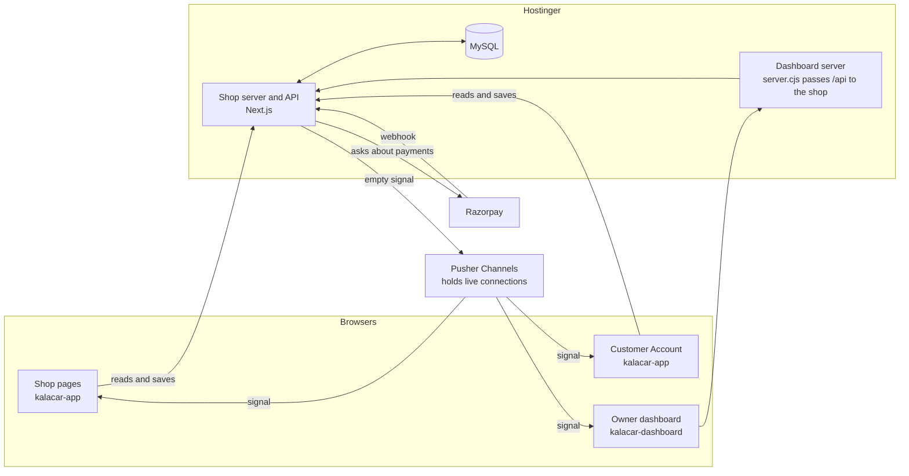
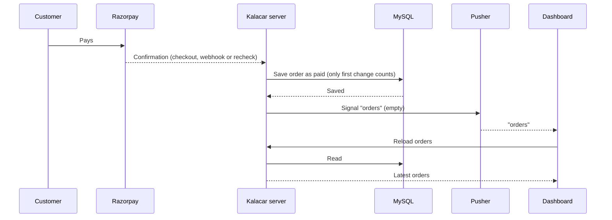

# 20 — Live Updates Architecture

How Kalacar keeps the shop, customer accounts and owner dashboard up to date without pages constantly asking the server. Read this before adding anything that changes data or shows live data.

## The system in one picture



**The main rule: Pusher only says that something changed. Pages always reload the data from Kalacar's own server, and MySQL stays the single source of truth.**

## Why it's built this way

The first version had every open tab ask the server every 2.5 seconds. It felt instant, but it never stopped while a tab was open: one shop tab caused 48 requests and about 144 database queries a minute.

Hostinger rules out the usual fix. Its [Node.js limits](https://www.hostinger.com/support/hostinger-node-js-limits-for-web-and-cloud-plans/) (checked 2026-11-06) say:

- Incoming WebSockets aren't supported.
- A request is stopped after 120 seconds, so a long-lived stream (SSE) would probably be cut. The page doesn't mention SSE by name.
- Always-running background workers aren't supported, and endless timers stop on a restart. It recommends cron jobs.
- Business plans have a limit of 60 entry processes; hitting a limit can cause 503 errors.

| Option | Decision | Reason |
|---|---|---|
| Ask every few seconds | Rejected | Load grows with every open tab and never stops |
| WebSockets on Hostinger | Not possible | Not supported |
| SSE on Hostinger | Rejected | 120-second limit; could use up process limits |
| **Pusher Channels** | **Chosen** | Pusher holds the connections; the server only sends a message when something changes |

We chose Pusher over Ably because Pusher's free limits were clear on its [pricing page](https://pusher.com/channels/pricing/).

## How a change travels



The signal is always sent **after** saving, so a page that reloads can't read old data.

## Channels and who can listen

| Channel | Who joins | Signals | How access is checked |
|---|---|---|---|
| `shop` | Anyone on the shop | `products`, `store` | Public, and it carries no data |
| `private-owner` | Owner dashboard | `orders`, `products`, `store`, `coupons`, `settings` | `POST /api/realtime/auth/owner` needs the owner session |
| `private-customer-<userId>` | That customer | `orders` | `POST /api/realtime/auth/customer` needs the shop session and a matching ID |
| `presence-product-<id>` | Anyone viewing that product, only if the owner turned on viewer counts | None; used only to count real viewers | `POST /api/realtime/auth/customer` gives a random ID, with no sign-in needed |

- Rules are in `kalacar-app/src/lib/realtime-channels.ts`.
- The shop and dashboard use separate auth routes and sessions, as `AGENTS.md` requires. A shop sign-in can never join the owner channel.
- Signal messages are empty. Pusher sees channel names (a customer's includes their account ID) and event names, but no name, address, phone or payment details.

## What sends each signal

| Change | Signal | Who hears it | Sent from |
|---|---|---|---|
| New order, paid, failed, cancelled, refund, delivery status, tracking | `orders` | Owner and that customer | `signalOrder()` in `catalogue-db.ts` |
| New order, cancellation, refund, or setup failure (stock can change) | `orders` and `products` | Owner, customer and shop | `signalOrder(id, true)` |
| Product, colour, price, stock or category edit | `products` | Shop and owner | `signalled()` around the admin route |
| Shop status, banner, gift offer | `store`, `settings` | Shop (`store`) and owner (both) | `signalled()` on `admin/settings` |
| Website link, message templates, print label | `settings` | Owner | `signalled()` around the admin route |
| Home page, product page settings, pages, reviews | `store`, and `settings` for site settings | Shop and owner | `signalled()` around the admin route |
| New or changed contact message | `inquiries` | Owner | `announce()` and `signalled()` |
| Coupon edit | `coupons` | Owner | `signalled()` around the admin route |

Saved settings also send `store` to the shop when only an owner setting changed. That's a small extra reload, not a problem.

**Not live on purpose:** a Settings card someone is editing doesn't reload by itself, so a signal can't overwrite what they're typing. It loads fresh when the page opens. The Thank you page shows the saved order once. Saved addresses and bag contents belong to one browser or account and update through their own actions.

## How pages behave

### Shop and customer account: `src/lib/realtime-client.ts`

`useLiveLoad(topics, load, customerId?)` runs `load` when a signal arrives.

| Situation | What happens | Requests |
|---|---|---|
| Visible, connected | Reloads on a signal; backup every 5 minutes | Only on change, plus the backup |
| Visible, not connected | Backup every 60 seconds | 1 a minute per data type |
| Hidden tab | Disconnects | None |
| No activity for 30 minutes | Disconnects | None |
| Coming back | Reconnects and reloads once | One reload per data type |

`cart-provider.tsx` holds the only product request for the shop. A failed reload keeps what's on screen, except a closed shop (403), which clears the products.

### Dashboard: `kalacar-dashboard/src/realtime.ts` and `src/live.ts`

The dashboard stays connected while open, even when hidden, so new-order sounds still play. It's owner-only, so that's only a few connections.

- `useLiveRevision(enabled, ...topics)` gives a number that goes up on each signal. Views use it as an effect dependency to reload.
- `useOrderChanges` adds a small check of `GET /api/admin/orders/changes`: every 60 seconds when connected, every 15 seconds when not.
- Full views have a 5-minute backup while visible.
- A background reload keeps the list on screen, so there's no loading flash and a brief failure doesn't empty it.

### Server cache: `src/lib/shop-products.ts`

Visitors share one read of the public product list for up to 15 seconds. A `products` signal clears it, so the reload after a signal is fresh. It's held on `globalThis` so all routes share it. This assumes one server process, which is what Hostinger runs for each site. Moving to several processes means replacing it with a shared cache.

## Keeping payments correct

Pusher never decides whether something is paid. Payment status comes from these, and all are safe to repeat because only the first change to paid takes effect:

1. **Checkout:** `POST /api/checkout/verify` checks the signature.
2. **Webhook:** `POST /api/webhooks/razorpay`. [Razorpay can send events twice or out of order](https://razorpay.com/docs/webhooks/best-practices/), and advises checking its API as well.
3. **Recheck:** `src/lib/order-reconcile.ts` asks Razorpay about up to 5 unpaid orders from the last 2 hours, at most once a minute. It currently runs when a dashboard makes its check.
4. **Customer sync:** the Account page and Retry ask Razorpay about that customer's unpaid orders.

Checkout re-checks and locks stock on the server, so an older product list on screen can't oversell.

**Open gap:** if a customer closes the page right after paying and no dashboard is open, nothing confirms the payment until someone opens one or the customer visits Account. The webhook and a Hostinger cron job close this. See [[16-progress-checklist]] Stage 5.2D.

## When something fails

| Failure | What the user sees | Recovery |
|---|---|---|
| A signal is lost | A short delay | Backup timers, or on returning to the tab |
| Connection drops | A short delay | Automatic reconnect, then a reload |
| Pusher is down or keys are missing | Slower updates | Falls back to timers |
| Over the free limit | Some tabs update more slowly | Falls back to timers; upgrade the plan if it keeps happening |
| A signal can't be sent | Nothing | Logged; the save itself still succeeds |
| Database down | Existing data stays on screen | Next reload |

Payments, orders and browsing don't depend on Pusher.

**How that's protected in code:**
- Signals are sent without waiting, inside a safety catch, so a slow or broken Pusher can't delay or fail a save.
- Pusher's browser code only loads after the settings are fetched, and any failure there is ignored.
- When not connected, pages use timers: the shop every 60 seconds, dashboard orders every 15 seconds.
- `GET /api/realtime/config` reads the running server's settings. It must keep `await connection()`, or a production build freezes the settings at build time. Testing found this bug.

**Tested 2026-11-06 with Pusher failing:**
- Unreachable region on a production build of the shop: the page loaded normally, with 1 product request, then 1 more about a minute later.
- Unreachable region and wrong key on the dashboard: a pretend paid order still appeared in about 10–11 seconds.
- Pusher rejecting, throwing or never answering: saves still succeed (unit tests).

Not tested: a real Pusher outage while pages are already connected, and a real order saved while Pusher is failing.

## New-order alerts use the same path

- **Sound and count:** `src/order-alerts.tsx` reloads on the `orders` revision and alerts for newly paid order IDs.
- **Browser push:** `src/lib/owner-alerts.ts` and `public/sw.js`. It reaches a device with the dashboard closed, and also tells open tabs to check straight away.
- **Telegram:** planned; see Stage 5.2C.

## Settings

Set in `kalacar-app/.env.local` locally, and in the host's settings online. Never put values in chat, notes, Git or screenshots.

| Variable | Secret? | Used for |
|---|---|---|
| `PUSHER_APP_ID` | Low risk | Which Pusher app |
| `PUSHER_KEY` | No, browsers see it | Pages connect with it; sent by `GET /api/realtime/config` |
| `PUSHER_SECRET` | **Yes** | Server sends signals and approves private channels |
| `PUSHER_CLUSTER` | No | Region; `ap2` is Mumbai |

The dashboard needs no Pusher settings, because it gets the key from the shop. Leaving them out switches live updates off without breaking anything.

If the secret leaks, create a new one in Pusher and update the settings.

## Limits and cost

Free Sandbox plan: **100 connections at once and 200,000 messages a day**. The next plan is $49 a month for 500 connections and 1 million messages a day (checked 2026-11-06). One connection is one connected tab. Check usage in the Pusher dashboard.

## Adding something new

**A new saving route:**
```ts
export const PATCH = signalled(["products"], handlePatch);
```
Order changes go in `catalogue-db.ts`: call `signalOrder(id)` after the save, or `signalOrder(id, true)` if stock changed.

**A new view on the shop:**
```ts
useLiveLoad("products", load);                     // everyone
useLiveLoad("orders", load, user?.id ?? null);     // one customer
```

**A new view on the dashboard:**
```ts
const revision = useLiveRevision(signedIn, "coupons");
// add revision to the effect that loads the data
```

**Please don't:** put data in a signal, send a signal before saving, add a short repeating timer, or add a cookie or limit shared by the shop and dashboard.

## Testing

Automatic tests live in both projects and use pretend data, so they never touch the database.

```bash
npm test                # unit tests: rules such as payments, channels and link safety
npm run test:browser    # opens pages at phone and desktop sizes in Brave; dev server must be running
npm run test:all        # both
```

Run these in `kalacar-app` and `kalacar-dashboard` before merging. Set `TEST_BROWSER` to use another browser. `npm run qa` in `kalacar-app` is a separate older suite that needs a separate test database.

To try a real signal: open a page, make a change in the dashboard, and watch the page update with no reload. In the browser's Network tab, a page left alone should make very few requests, and a hidden tab none.

**Checked 2026-11-06 with real Pusher:**
- A shop signal reloaded products.
- A hidden tab made no requests, and coming back reloaded once.
- An owner signal on the private channel showed a pretend paid order about 0.14 seconds after sending.
- With live updates off, the dashboard showed it within about 15 seconds.
- Channel rules refuse other people's channels, and signed-out requests are refused.

**Still to check:** a real test payment end to end, real saves from a signed-in dashboard, a real customer's Account page, the 30-minute idle rule, a Pusher outage, two owners at once, the hosted site, and browser push on a real device.

## Key files

| File | Purpose |
|---|---|
| `kalacar-app/src/lib/realtime.ts` | Sends signals; `announce`, `announceOrder`, `signalled` |
| `kalacar-app/src/lib/realtime-channels.ts` | Channel names and access rules |
| `kalacar-app/src/lib/realtime-client.ts` | Shop connection and `useLiveLoad` |
| `kalacar-app/src/app/api/realtime/` | Config and channel approval routes |
| `kalacar-app/src/lib/shop-products.ts` | Shared product list cache |
| `kalacar-app/src/lib/order-reconcile.ts` | Rechecks unpaid orders with Razorpay |
| `kalacar-dashboard/src/realtime.ts` | Dashboard connection and `useLiveRevision` |
| `kalacar-dashboard/src/live.ts` | `useOrderChanges` and backup refresh |

See also [[19-how-kalacar-works]], [[flows/09-live-updates.excalidraw|the live updates drawing]], and [[16-progress-checklist]].
